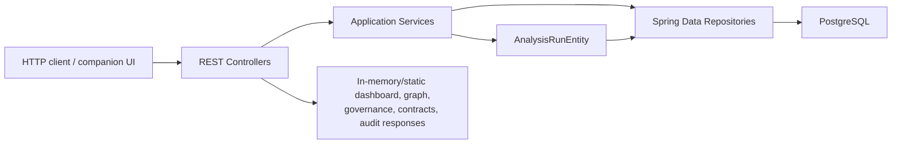

# Architecture

## Overview

`impact-analysis-springboot` is a Java 21 / Spring Boot REST backend for an AI-powered cross-repository pull-request impact-analysis proof of concept. It provides customer CRUD operations, persists impact-analysis run results and reports, exposes dashboard and dependency-graph data, and presents governance, integration-health, and audit views.

The application is centered on three responsibilities:

- Customer registration and retrieval through JPA-backed REST endpoints.
- Recording and querying impact-analysis runs and reports.
- Supplying static or in-memory dashboard, graph, contract, governance, and audit information for UI integration.

## Tech Stack

| Area | Technology |
|---|---|
| Language/runtime | Java 21 |
| Framework | Spring Boot 3.4.2 |
| Web/API | Spring MVC / `spring-boot-starter-web`, Springdoc OpenAPI 2.8.5 |
| Persistence | Spring Data JPA, Hibernate, PostgreSQL runtime driver |
| Database migrations | Flyway Core and Flyway PostgreSQL support |
| Validation | Jakarta Bean Validation |
| Observability | Spring Boot Actuator, Micrometer Prometheus registry |
| Development/test databases | H2; PostgreSQL in main configuration |
| Build | Apache Maven |
| Containerization | Multi-stage Dockerfile with Eclipse Temurin 21 |

## Repository Structure

```text
src/main/java/com/example/impactanalysis/
├── ImpactAnalysisApplication.java
├── config/                 # OpenAPI and CORS configuration
├── controller/             # REST endpoints
├── dto/                    # API request and response models
├── entity/                 # JPA persistence entities
├── exception/              # Central exception handling
├── repository/             # Spring Data JPA repositories
└── service/                # Service interfaces and implementations

src/main/resources/
├── application.yml         # Server, datasource, JPA, Flyway, CORS, Actuator
├── application-local.yml   # Local-profile configuration
└── db/migration/           # Flyway V1 and V2 schemas

.github/
├── workflows/              # CI and cross-repository impact-analysis automation
└── skills/                 # Repository documentation skill

Dockerfile
pom.xml
openapi.yaml
service-catalog.yml
impact-policy.yml
```

## Architecture and Data Flow



### Layers

- **Controllers** handle HTTP mappings, validation, pagination/filter parameters, report formatting, and HTTP status codes.
- **Services** normalize customer input, enforce duplicate-email and not-found behavior, persist analysis runs, apply filters, and aggregate metrics.
- **Repositories** use Spring Data JPA for customers and analysis runs. `AnalysisRunRepository` adds a multi-filter JPQL query and severity/gate count methods.
- **Entities** map persisted customer and analysis-run records.
- **Exception handling** converts validation, duplicate, missing, illegal-argument, and uncaught exceptions into structured `ErrorResponse` bodies.
- **Configuration** provides CORS, OpenAPI/Swagger, datasource, Flyway, JPA, and Actuator settings.

## Persistence

Flyway migrations create:

- `customers`: customer name, normalized email, phone, optional message, and creation timestamp.
- `analysis_runs`: unique run ID, repository and commit details, PR and branch metadata, severity and gate decision, metrics, optional Markdown/JSON reports, and creation timestamp.

JPA validation mode is enabled (`ddl-auto: validate`) and `open-in-view` is disabled.

## Key Entrypoints

- Main class: `com.example.impactanalysis.ImpactAnalysisApplication`
- REST base paths: `/api/customers`, `/api/analysis`, `/api/dashboard/metrics`, `/api/contracts`, `/api/graph`, and `/api/governance`.
- OpenAPI: `/v3/api-docs`
- Swagger UI: `/swagger-ui.html`
- Actuator: `/actuator/health`, `/actuator/info`, `/actuator/metrics`, `/actuator/prometheus`

## Configuration

| Setting or variable | Default | Purpose |
|---|---|---|
| `server.port` / `SERVER_PORT` | `8080` | HTTP listener |
| `SPRING_DATASOURCE_URL` | `jdbc:postgresql://localhost:5432/customer_db` | PostgreSQL JDBC URL |
| `SPRING_DATASOURCE_USERNAME` | `postgres` | Database username |
| `SPRING_DATASOURCE_PASSWORD` | `postgres` | Database password |
| `CORS_ALLOWED_ORIGINS` | `http://localhost:5173` | Comma-separated allowed CORS origins |
| `spring.jpa.hibernate.ddl-auto` | `validate` | Require Flyway-managed schema |
| `spring.flyway.enabled` / locations | enabled / `classpath:db/migration` | Flyway migration execution |

The Docker image listens on port 8080 and runs as a non-root `spring` user. Its health check calls `/actuator/health`.
